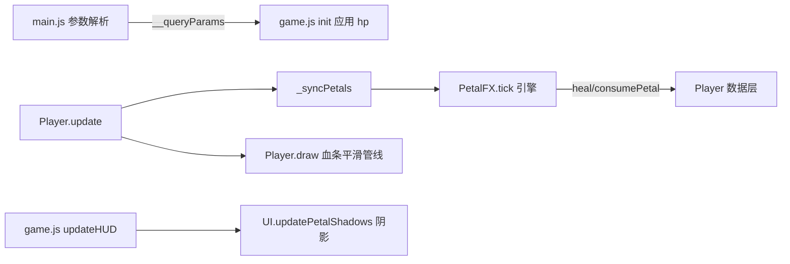

## 产品概述
对 florr.io 还原项目进行一批战斗反馈与系统修正：新增可自由组合的 URL 调试参数、重构主血量条为“平滑跟随 + 淡灰缓冲条 + 连续颜色渐变”、优化伤害数字动效、修复装备花瓣增加人物血量上限的 bug、调淡受伤红闪、将玫瑰花瓣效果剥离为独立特效引擎并修正其触发时机、修复卡槽水缸阴影不显示的问题。

## 核心功能
- **URL 调试参数**：`?hp=100000` 等数字参数解析为当前主人物血量；支持逗号与 `&` 混搭组合（如 `?mode=debug,hp=1000,lang=zh_cn`）；`lang` 与现有 `i18n` 别名等价
- **主血量条平滑动画**：绿色主条快速移动到新血量位置；其后淡灰色缓冲条以较慢速度跟随并轻微过冲（平时不可见）；颜色随血量从绿到红连续平滑渐变（非三档区间），血量与颜色变化均平滑；黑框、整体长度均不变
- **昆虫血条颜色**：同步改为绿→红连续渐变
- **伤害数字**：弹出更快、渐隐更短促、带 Q 弹（easeOutBack）弹出感，Ubuntu 粗体数字
- **血量上限修复**：花瓣血量独立于人物血量，装备花瓣不再增加 maxHp
- **红闪调淡**：人物/昆虫/花瓣受伤红色滤镜整体更淡
- **玫瑰效果修正**：必须 reload 完成且已弹出至轨道后才检测；之后任何时候人物血量不满都立即触发回血（1.5s 飞向主角 → 回血 → 自己退场消失），而非仅在生成瞬间判定
- **水缸阴影修复**：卡槽内花瓣血量不足时淡灰水位可见且平滑变化
- **花瓣特效引擎剥离**：新建独立文件，提供自定义花瓣效果注册格式与多组 API（检测/执行/绘制/治疗/消耗），检测与效果可自由组合；玫瑰作为首个内置特效迁入，供后续用户自建特效花瓣扩展


## 技术栈
纯 HTML/JS/Canvas（无构建工具），沿用现有 `?v=N` 版本号缓存管理；新文件 `js/petal-effects.js` 挂全局 `PetalFX` 对象。

## 实现方案
### 1. URL 参数（js/main.js + index.html）
- main.js：将现有 `URLSearchParams` 解析改为“逗号/`&` 双兼容”解析器（`location.search.replace(/,/g,'&')` 后走 URLSearchParams，与 index.html 内联语言脚本同款做法），产出 `window.__queryParams = { mode, hp, lang, ... }`；`__debug` 语义不变
- `hp` 为正整数时应用到玩家：`maxHp = hp; hp = maxHp`（在 game.js init() 创建玩家并 recompute 后设置，避免被 recompute 覆盖）
- index.html 内联语言脚本：`i18n` 正则扩展为 `(?:i18n|lang)=`，支持 `lang=zh_cn`
- 参数校验：hp 非法值（NaN/≤0）忽略，保持默认 100

### 2. 血量上限修复（js/entities.js Player.recompute）
- 根因：`this.maxHp = Math.max(20, 100 + hp)` 把花瓣 st.hp 累加进人物上限
- 修复：maxHp 固定基准 100（花瓣 hp 不参与），dmg/spd 聚合保留；删除无用 hp 变量

### 3. 主血量条平滑管线（js/entities.js Player）
- 新增运行时字段：`dispHp`（显示值，指数阻尼快速跟随 hp，rate≈18）、`ghostHp`（缓冲条值，欠阻尼弹簧慢速跟随 dispHp 且允许轻微过冲，平时贴满不可见）
- 受击时 dispHp 快速下移露出 ghostHp（初始=受伤前血量），ghostHp 慢速追 dispHp 并过冲一小段再回稳；回血时主条快速上移、缓冲条淡灰被覆盖同样自然
- 绘制顺序（黑框内）：淡灰缓冲条（先画）→ 绿色主条（后画，宽度=bw*dispHp/maxHp，不超黑框）；颜色用 hue 连续插值 `hsl(110→0, 饱和度/亮度插值)`，随 dispHp 每帧计算
- 黑框、HPBAR_W/HPBAR_H、血条渐显渐隐逻辑（hpBarA）全部不动
- Mob 血条（Mob.draw）：仅改三档颜色为同一连续插值函数（复用公共 helper `hpBarColor(ratio)`），不加缓冲条

### 4. 伤害数字（js/entities.js DamageText）
- 寿命 0.8s→约 0.55s；上浮初速保留、衰减加快
- 弹出期（前 0.15s）scale 走 easeOutBack Q 弹（复用现成 spawnPop 的 c1=1.70158 曲线），末段 alpha 加速渐隐
- 字体改 `800 16px Ubuntu`（用 CardRenderer.FONT 统一字体栈，离线自动回退），黑描边保持

### 5. 红闪调淡（js/entities.js）
- Mob 本体与描边圈红层 0.85→0.55；Player 0.6→0.4；花瓣 0.6→0.4；0.3s 时长与渐隐节奏不变

### 6. 花瓣特效引擎（js/petal-effects.js 新文件）
```js
const PetalFX = {
  defs: {},
  register(key, def) { /* def = { detect(ctx)?, update(ctx, dt)->完成?, draw?(ctx)? } */ },
  tick(body, player, dt) { /* 未激活: 每帧 detect(ctx) 命中则 start；激活: 调 update，返回 true 即结束 */ },
};
```
- ctx API：`player / petal / stats / dt / onOrbit()`（age≥0.2s 视为已弹出至轨道）、`heal(n)`（min 到 maxHp）、`consumePetal()`（转退场幽灵 + 重置该槽装填，与现 _destroyPetal/_syncPetals 行为一致）、`gone()`
- 花瓣 body 运行时字段：`b.fxActive`、`b.fx = { key, state }`、`b.fxNoCombat`；激活后特效直接驱动 b.x/b.y，轨道弹簧跳过该花瓣
- 玫瑰内置注册：detect = `onOrbit() && stats.heal>0 && player.hp<player.maxHp`（每帧检测 → “加载好且之后血量不满立刻触发”）；update = 1.5s smoothstep 从触发点飞向主角，结束时 heal + consumePetal（转退场幽灵渐隐）
- 接线：Player._syncPetals 删除内联玫瑰逻辑，在 bodies 循环后对每片花瓣调 `PetalFX.tick(b, this, dt)`；_syncPetals spring 循环跳过 fxActive 花瓣；game.js _combatTick 改判 `b.dead || b.fxNoCombat`
- 引擎为纯检测/驱动层，无 DOM、无状态泄漏；每片花瓣 state 独立，随 body 生命周期销毁

### 7. 水缸阴影修复（js/game.js + css/style.css）
- 根因已定位：game.js 存在两个 `updateHUD` 定义，line ~677 的后者覆盖了带 `UI.updatePetalShadows` 的前者，导致水位永远 0%
- 修复：删除重复定义（保留带阴影更新版）
- CSS 增强：pshadow 渐变加深（rgba(6,10,26,0.72)→0.38）+ 顶缘 1px 浅色亮线，让水位更易读；transition 保持 0.15s

### 8. 性能与可靠性
- 血条平滑为每帧 O(1) 阻尼计算；PetalFX.tick 为 O(花瓣数)（≤10），detect 均为 O(1) 判断
- 版本号 bump：index.html 中 css 37→38、main.js 11→12、entities 57→58、game 37→38，新增 `js/petal-effects.js?v=1`（置于 data.js 之后、entities.js 之前）；ui.js 无改动不 bump

## 架构


