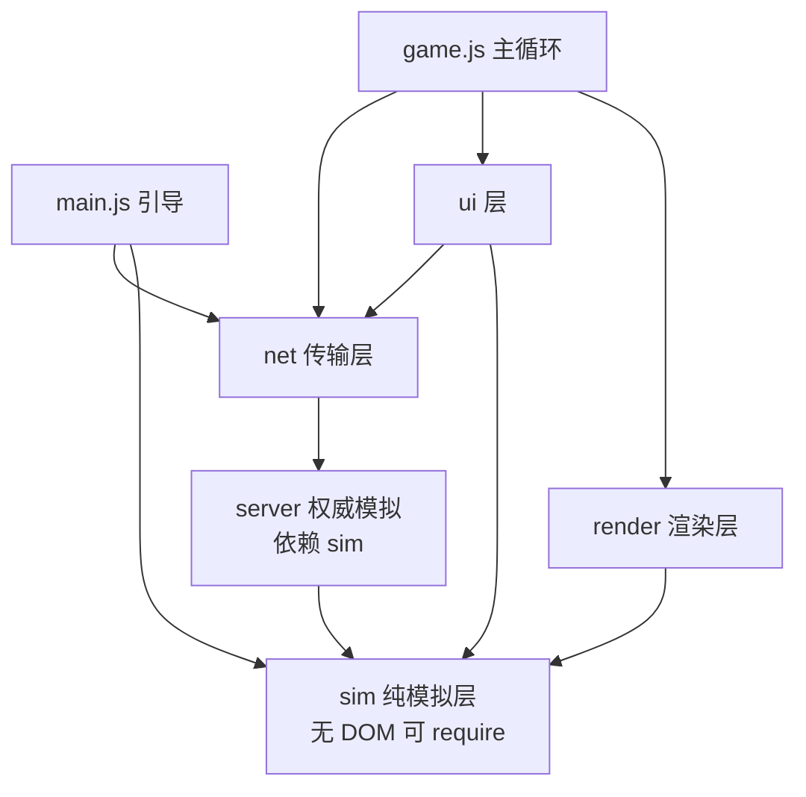

## 产品概述
florr2 是 florr.io 的浏览器端复刻（仅 Garden 一张图），纯前端 `HTML + CSS + 原生 JS + Canvas 2D + DOM 覆盖层`，零构建、零依赖、`index.html` 顺序加载全局脚本。本次不改玩法与视觉风格，针对工程本身做一次全面体检与重构。

## 核心需求
1. **拆除过度设计**：把"简单机制却写大量逻辑"的地方收敛——进程内消息协议、4 套飞卡动画、canvas 手绘 tooltip、三档小地图重复预热、单函数 340 行的花瓣同步、15 个并行缓存表，均按"够用且可读"重写。
2. **修复已确证 BUG**（不改玩法手感，只让行为符合设计）：
   - 死亡重生后花瓣世代号失配，导致该槽花瓣永久不掉血、不红闪、不碎裂；
   - 地面持续型花瓣（Pollen/Honey）被打碎时客户端错误重置冷却，与服务端错位；
   - 击退总位移不守恒且带随机，设计值被放大 2~2.5 倍；
   - 换卡期间服务端不暂停装填，客户端还在扇形阴影时怪已掉血；
   - 客户端推挤使用视图生物导致预测位置持续漂移与 90px 橡皮筋；
   - 快照常量声明 25Hz 实际 60Hz，高刷屏插值滞后；
   - 四条重生路径字段清单不一致，卡顿累积器丢弃时间。
3. **网络层做成真可替换**：协议消息为纯数据；客户端不得触碰服务端内部对象；权威模拟核心剥离 DOM/Canvas 依赖，可在 Node 进程加载；提供 WebSocket 客户端实现与连接失败回退本地。为将来"起一个 Node 进程即开服"预留完整条件。
4. **引擎接口名副其实**：`PetalFX` 覆盖全部特殊花瓣（leaf/honey/peas 等），`SpriteStore` 成为唯一图像入口，`PETAL_TYPES`/`MOB_TYPES` 成为唯一数据源，不再散落 slug/数字 id 硬编码。
5. **性能优化**：先裁剪后排序、收紧视口余量、快照降频与对象复用、名牌与卡面缓存、花瓣扫描去分配、UI 每帧操作降本、瓦片分块缓存。
6. **文件整理**：按"纯模拟 / 渲染 / 传输 / 服务端 / UI"分层拆分 4 个巨型文件；**不删除、不移动任何 assets、scripts、tools 文件**；新增文案走独立 `js/i18n-extra.js`，不改抓取生成的语言包。
7. **可自动验收**：提供 Agent 可独立执行的自测通道（页面内断言 + 性能基准 + 脚本一键判定），无需人工点按。

## 视觉与体验
无界面改版。除修复项带来的正常表现（击退距离回到设计值、花瓣碎裂反馈正确、高刷屏插值更跟手、帧率更稳）外，外观与交互保持现状。


## 技术栈
沿用现有技术栈，不引入构建链与任何依赖：

- 语言/渲染：原生 JavaScript（ES2020，非模块全局脚本）、Canvas 2D、DOM 覆盖层
- 样式：单一 `css/style.css`
- 资源加载：`fetch` + 离屏 Canvas 预渲染（现有 `SpriteStore`）
- 自测：Python 3.13（标准库 `http.server` / `subprocess` / `json`）+ 系统已安装的 Chrome/Edge headless（`--headless --dump-dom --virtual-time-budget`）
- 兼容性：同一份模拟层文件通过文件尾 `if (typeof module !== 'undefined') module.exports = {...}` 同时支持浏览器全局与 Node `require`，不使用 ESM/打包

## 实现策略

### 总体方法
先建立"可自动判定的基线"，再按"行为修复 → 分层拆分 → 接口统一 → 性能优化 → 清理与文档"的顺序推进。每一阶段结束都跑一次自测，确保拆分是纯机械搬迁、行为修复是可归因的。

关键取舍：**不在拆分的同时改行为**。巨型文件（`entities.js` 2200 行、`ui.js` 2250 行）的拆分采用"先按现有函数边界切文件、再在新位置做逻辑修正"，避免一次 diff 里同时出现搬迁与语义变更而无法定位回归。

### 关键决策与理由

1. **命名空间取代裸全局函数**
   现状 `roundRectPath` 在 `ui.js:24`、`entities.js:247`、`cards.js:397` 各定义一份，而 `ui.js` 先加载、被 `entities.js` 静默覆盖（当前两份实现恰好相同才没炸）。拆分后文件更多，裸全局风险指数上升。改为每个模块用 IIFE 暴露单一命名空间（`window.Sim`、`window.Render`、`window.NetProto`、`window.UIX`），跨模块只调命名空间成员。这是本次重构的必要前提，不是装饰。

2. **实体类只保留状态，绘制外置**
   当前 `Player`/`Mob` 的 `draw()` 与物理耦合，且物理依赖 `SpriteStore.contour`，导致模拟层无法在 Node 运行——这正是"Node 开服"的头号障碍。拆为 `sim/player.js`（状态 + 每步推进）与 `render/player-render.js`（`Draw.player(ctx, p, time)`）。轮廓改为依赖注入：`Sim.MobShape.setProvider(fn)`，浏览器注入 `SpriteStore.contour`，Node 注入 `assets/mob-shapes.js` 的预计算数据。`Player`/`Mob` 的公开字段名保持不变，降低渲染层迁移风险。

3. **协议真序列化，而非对象引用直传**
   现状快照直接传内部对象（`net.js:1201-1247`），且 `_recipients()` 恒 `return []`（`net.js:1061`）使 `heard===0` 分支永真。改造为：`NetProto` 定义消息 `type + payload` 与字段白名单；快照只含基本类型（数字/布尔/定长数组），客户端 `_applySnap` 只读白名单字段。同时清掉"发了不读"（`snap.t`、`bodyDmg`、`kill.id/level`、`respawned.cp`、`hurt.shake`）与"读了不发"（`chat.js:523` 的 `whisper`）的死字段，使协议即文档。

4. **客户端不得触碰权威对象**
   `game.js:212/185-190/256-258`、`chat.js:361/367/451` 六处 `net.server.*` 直连改为正式接口：`net.request(kind, payload)` 返回 Promise（本地实现直接同步 resolve，远端实现走 ack 超时），以及 `net.on('snap'|'evt')`。`LocalNet` 内部持有 server 但外部不可达，自测里加"禁止访问 `net.server`"的断言，防止回潮。

5. **掉落与拾取权威化**
   现状掉落生成与拾取 100% 在客户端（`game.js:669-697`、`:560-578`），预测位置直接决定"隔空捡到"，且服务端批量击杀会给屏幕外生物生成掉落。改为服务端生成掉落与判定拾取、通过事件通知客户端播放飞卡动画。这是联机的必要条件，也能顺带修掉上述两个表现问题。

6. **快照按 SNAP_HZ 节流，模拟保持 60Hz**
   `LocalNet.step` 内分离"模拟推进"与"快照投递"：模拟仍每固定步执行，快照用累加器按 `SNAP_HZ` 投递。表现类关键反馈（受伤/击杀/碎裂）继续走即时事件通道，因此 40ms 的快照间隔不会让玩家看到延迟。顺带把散落 7 处的 `1/25` 收敛到 `Sim.Constants`。

7. **性能优化只做有证据的部分**
   审计已确认最大三处开销是"全量排序后裁剪""25 屏裁剪余量""60Hz 全量快照"。这三项收益最高、风险最低，先做；名牌离屏缓存、花瓣扫描去分配、UI 每帧降本其次；瓦片分块缓存工程量最大放最后，并保留回退开关。

8. **自测不依赖 Node**
   本机 `node` 不可用（已实测），因此自测走"页面内自检 + Python 驱动 headless 浏览器"：`?selftest=1` 时 `main.js` 动态加载 `js/selftest.js`（正常运行零成本），自检脚本用固定 dt 驱动固定帧数，收集未捕获异常、断言结果、性能分位耗时，序列化进 `<script id="selftest-result" type="application/json">`；`dev/selftest.py` 启动 `http.server`、调用 Chrome/Edge `--dump-dom`、解析 JSON 并以退出码表示成败。

### 性能与可靠性要点
- 模拟层复杂度：生物推进 O(N)，花瓣×生物命中为 O(P×N)，通过 `sleeping` 早退与花瓣外接圆预筛把实际常数压下来；`nearMobs` 预筛维持 O(N) 但去掉每帧数组分配与 `Math.hypot`。
- 渲染层：可见集合裁剪 O(N) + 可见集合排序 O(k log k)，k 约为屏幕内生物数（个位数到十几），相比现状 O(N log N)（N≈1600）是数量级改善。
- 快照：对象池复用，稳态下不再产生每秒数万个短命对象，降低 GC 停顿。
- 错误处理：资源加载保留 8s 超时与失败占位；`net.request` 加超时与拒绝路径；未识别消息不再静默丢弃，走统一日志（仅开发模式输出，不打印大数据）。
- 向后兼容：所有改动均在浏览器侧保持现有存档/设置键（`florr_settings` Cookie）与 URL 参数（`?hp=N`、`?magician`）语义不变。

## 架构设计



加载顺序原则：`util → assets → i18n → lang → i18n-extra → 数据 → cards → sim/constants → sim/*(除 arena) → petal/metrics → render/* → ui/* → map/* → ai → petal-effects → sim/arena → net/protocol → net/local-net → net/server/* → net/client → chat → game → main`。纯模拟层必须在 render/ui 之前，保证 Node 侧 require 不触碰浏览器 API。

## 数据契约与关键接口

只保留三处必须精确的契约，其余用文字描述。

```js
// 1) 传输层接口（net/client.js）—— 客户端唯一入口，禁止访问内部 server
class Net {
  connect(url) {}                 // 本地实现立即 resolve，远端实现建连接
  send(msg) {}                    // 单向消息，不保证回执
  request(kind, payload, opts) {} // 返回 Promise，带超时；用于 teleport/respawn/查询
  on(type, cb) {}                 // 'snap' | 'evt' | 'status'
  step(dt) {}                     // 本地实现推进内嵌 server；远端实现为空
  close() {}
}

// 2) 快照契约（net/protocol.js）—— 只允许基本类型，字段即文档
// snap = {
//   tick: number,
//   player: { x, y, hp, maxHp, dead, invuln, bodyDmg, level, xp, xpNext, ... },
//   petals: [{ slot, sub, gen, hp, maxHp, dead, x, y }],
//   ents:   [{ netId, typeId, x, y, vx, vy, hp, maxHp, rarity, sleeping, ... }],
//   drops:  [{ id, key, rarity, x, y }]
// }

// 3) 模拟层导出约定（每个 sim 文件尾部）
if (typeof module !== 'undefined') module.exports = { Player, Mob, ... };
```

## 目录结构

```
florr2/
├── index.html                      # [MODIFY] 重排脚本顺序、新增分层文件、bump 各 ?v=（assets 引用保持原值）
├── AGENTS.md                       # [MODIFY] 同步真实常量/启用项/生成器/自测用法，补分层说明
├── js/
│   ├── util.js                     # [MODIFY] 成为唯一基础工具源：roundRectPath/fmtNum/clamp/damp/dist2；删 noise1；Settings 不变
│   ├── assets.js                   # [MODIFY] 六个同构 canvas 变体合并为 _variant(key,size,{crop,tint,flip})；删 shape/artRect/whiteCanvas；保留 8s 超时
│   ├── lang.js                     # [MODIFY] t(key, fallback) 真正使用 fallback；新增 addPack/addKeys 供 i18n-extra 增量注册
│   ├── i18n-extra.js               # [NEW] 本次新增文案的唯一落点（加载失败提示、标签页标题、自检输出），不动 assets/i18n
│   ├── data.js                     # [MODIFY] 花瓣/生物特殊参数下沉为 type 字段；MOB_DROP_ITEMS 键由数字 id 改 slug；常量收敛
│   ├── cards.js                    # [MODIFY] 图像统一经 SpriteStore；删内部 roundRectPath/darken/fmtNum 副本；补加载失败兜底；清理 _imgWait
│   ├── ai.js                       # [MODIFY] 删 facing()/walked 等死成员，保持只输出移动欲望的契约
│   ├── petal-effects.js            # [MODIFY] 扩展 ctx：持续型（每 tick）、多次喷射、硬碰撞、装填挂钩；迁入 leaf/honey/peas
│   ├── sim/
│   │   ├── constants.js            # [NEW] 唯一常量源：SPEED_SCALE/PLAYER_BASE_SPEED/KNOCKBACK_*/FLOWER_*/SNAP_HZ/TICK_DT/MOB_ACTIVE_R
│   │   ├── physics.js              # [NEW] physicsPush/moveEntity/applyKnockback/碰撞解算，含"推挤后复查地形"
│   │   ├── player.js               # [NEW] Player 状态与每步推进（装填、轨道、击退、无敌、死亡），不含绘制
│   │   ├── petal-body.js           # [NEW] 花瓣实体与统一碎裂/重装规则（stationary 判断只留一份）
│   │   ├── mob.js                  # [NEW] Mob 状态、AI 驱动、血量平滑、休眠
│   │   ├── mob-shape.js            # [NEW] 轮廓数学与提供者注入（浏览器 SpriteStore / Node 预计算数据）
│   │   ├── drops.js                # [NEW] 掉落表、生成、拾取判定（服务端权威）
│   │   └── arena.js                # [NEW] 世界容器与固定步推进（ents/petals/drops），供 server 使用
│   ├── render/
│   │   ├── render-util.js          # [NEW] hpBarColor/parseColor/roundRectPath/drawSprite/drawArt/drawHpBar（血条 3 份合 1）
│   │   ├── player-render.js        # [NEW] 玩家本体、眼睛、花瓣、装填扇形、尸体与幽灵
│   │   ├── mob-render.js           # [NEW] 生物本体、斑点、红闪，名牌走离屏缓存
│   │   ├── drops-render.js         # [NEW] 世界卡牌/掉落卡/拾取飞行（阴影改预渲染发光）
│   │   └── fx.js                   # [NEW] Fx 基类 + Particle/DropSpark/DamageText（3 套同构类合 1）
│   ├── net/
│   │   ├── protocol.js             # [NEW] 消息类型、字段白名单、序列化与校验，可 require
│   │   ├── local-net.js            # [NEW] LocalNet：内嵌 LocalServer，模拟 60Hz / 快照 SNAP_HZ，对象池
│   │   ├── client.js               # [NEW] Net 基类 + WebSocketNet + 连接失败回退本地
│   │   └── server/
│   │       ├── server.js           # [NEW] LocalServer 生命周期、输入应用、快照组装（无 DOM）
│   │       ├── spawn.js            # [NEW] 生成区解析、权重抽取、补怪、检查点
│   │       ├── combat.js           # [NEW] 花瓣命中/伤害/击退/仇恨（唯一权威）
│   │       ├── commands.js         # [NEW] 聊天指令实现（含权限与参数校验）
│   │       └── snapshot.js         # [NEW] 快照编码与对象池
│   ├── ui/
│   │   ├── shell.js                # [NEW] UI.init 与窗口骨架、按钮绑定
│   │   ├── inventory.js            # [NEW] 快捷栏/背包/物品搬运
│   │   ├── dex.js                  # [NEW] 画廊与图鉴（共享稀有度分组构建器）
│   │   ├── reload.js               # [NEW] 装填扇形（元素缓存 + 档位量化重绘）
│   │   ├── tooltip.js              # [NEW] 悬浮框（简单分支改 DOM，复杂分支保留 canvas）
│   │   ├── drag.js                 # [NEW] 拖拽与吸附（4 套飞行合 1 的 flyCard）
│   │   ├── minimap.js              # [NEW] 小地图（档位表驱动 + 脏检查）
│   │   └── ui.js                   # [MODIFY] 收敛为门面：init/refs/回调注册，删 updateHUD 空壳与 3 个死包装
│   ├── map/
│   │   ├── geom.js                 # [NEW] pointInPolygon/normalizeWinding/transformTiledPoint/moveShape
│   │   ├── map.js                  # [MODIFY] 仅保留地图构建、碰撞、生成区、检查点
│   │   └── map-render.js           # [NEW] 瓦片渲染 + 分块缓存 + minimapCanvas
│   ├── chat.js                     # [MODIFY] 走 net 接口，删 squad/guild 装饰与重复 _matchPlayer
│   ├── game.js                     # [MODIFY] 主循环/相机/事件消费；裁剪后再排序；整合 overlay 每帧任务
│   ├── selftest.js                 # [NEW] 仅 ?selftest=1 加载：异常捕获、不变量断言、场景回放、性能基准、结果写 DOM
│   └── main.js                     # [MODIFY] 查询参数简化、预热去重、selftest 动态挂载、失败提示走 i18n
└── dev/
    ├── selftest.py                 # [NEW] 启 http.server + headless Chrome/Edge + dump-dom 解析 + 退出码
    └── check_versions.py           # [NEW] 校验 index.html ?v= 与 git 改动文件一致性、跨文件全局重名、i18n key 缺失
```

## 性能优化清单（按落地顺序）

| 顺序 | 优化 | 位置 | 收益 | 风险控制 |
|---|---|---|---|---|
| 1 | 先视口裁剪、再对可见子集排序 | `game.js render` | 高 | 余量取 max(最大生物半径, 单帧最大位移) |
| 2 | 裁剪余量由 2 屏降为 0.5 屏（含调试层同步） | `game.js` | 高 | 自测加"贴边生物不消失"断言 |
| 3 | 快照按 SNAP_HZ 投递、模拟仍 60Hz | `net/local-net.js` | 高 | 表现事件走即时通道 |
| 4 | 快照与差分对象池复用，键改数值 | `net/snapshot.js`、`game.js` | 高 | 池化后禁止闭包持有 |
| 5 | `_syncPetals` 去分配、`hypot` 改平方距、出参复用 | `sim/petal-body.js` | 高 | 出参复用需确认调用方不长期持有 |
| 6 | `_combatTick`/Honey 循环加 sleeping 早退 | `net/server/combat.js` | 中高 | 休眠半径远大于花瓣射程 |
| 7 | 名牌整块离屏缓存（名称+稀有度+血量档位） | `render/mob-render.js` | 高 | 血量量化 20 档，缓冲条仍实时 |
| 8 | 合并 overlay rAF 到主循环，静止提前返回 | `game.js`、`ui/*` | 中高 | 拖拽循环保持独立 |
| 9 | 装填扇形降本（元素缓存、一次遍历、30 档位重绘） | `ui/reload.js` | 中高 | 视觉允许 30 档粒度 |
| 10 | 小地图脏检查 + 复用可见集合 + 数值 key | `ui/minimap.js` | 中 | 大档位仍需全图人口 |
| 11 | 瓦片分块缓存与整数索引 | `map/map-render.js` | 中 | LRU 上限 + 回退开关 |

## 自测体系

- 入口：`python dev/selftest.py --port 8080 --browser chrome`，自动起静态服务器、调用 headless 访问 `?selftest=1`、解析结果、打印 PASS/FAIL 明细并以退出码返回。
- 页面内断言（`js/selftest.js`）：
  1. 全程无未捕获异常、无 `console.error`；
  2. 协议字段双向一致（服务端下发的每个字段客户端都有读取者，客户端读取的每个字段都有下发）；
  3. 花瓣世代号一致（回放：装备 Pollen → 死亡 → 重生 → 攻击，断言花瓣仍能掉血/碎裂）；
  4. 击退位移守恒（同一稀有度重复 20 次，总位移落在设计值 ±1%）；
  5. 装填暂停生效（换卡期间服务端不产出花瓣）；
  6. 重生后装备/背包/图鉴字段清单与服务端一致；
  7. 预测位置偏移长期不超过阈值（回放贴怪推挤 10 秒，记录最大偏差）。
- 性能基准：固定 600 帧、固定 dt，输出 p50/p95 帧耗时与单帧最大分配增量，重构前后对比存档在 `dev/`（仅新增文件）。
- 版本/完整性检查（`dev/check_versions.py`）：`?v=` 是否随改动 bump、跨文件全局标识符是否重名、`I18N.t` 使用的 key 是否都存在、资源引用路径是否有效。


## Agent Extensions
### Skill
- **lsp-code-analysis**
  - Purpose: 在删除死代码、合并重复实现、迁移函数前做语义级引用/实现查询，避免仅靠文本 grep 漏掉动态调用点（例如 `updateHUD` 空壳的 5 处调用、`Card` 类与 `DropCard` 的关系、`SpriteStore.get/getImage` 的真实使用面）。
  - Expected outcome: 每个待删符号都有"零引用"的语义证据；每个待合并实现都有完整的调用点清单，删除后不产生运行期 `undefined`。
### SubAgent
- **code-explorer**
  - Purpose: 在分层拆分与加载顺序重排后，跨文件复核调用链、全局命名空间冲突、脚本顺序依赖，并验证性能改动前后的热点是否真的被消除。
  - Expected outcome: 拆分后每个新文件的依赖与导出清单可核对；`index.html` 顺序无前向引用；无新的全局标识符覆盖；性能改动命中审计列出的具体行号。
