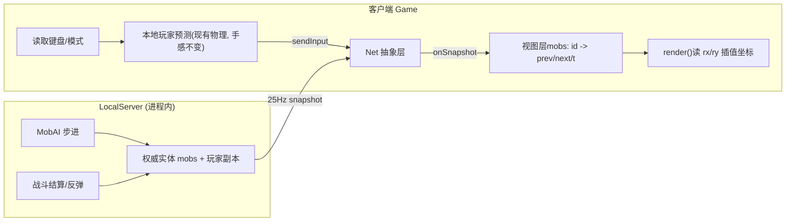

## 产品概述
为 florr.io 复刻项目补齐三项战斗反馈（通用无敌模式、按稀有度分配的碰撞反弹、真实受伤屏幕抖动），并新建网络抽象层把生物生成与玩家实体改为「输入上行 / 快照下行」的服务端权威结构，同时实现仿官方样式的全局聊天框（四频道标签、仅 Local 可用、无人收听时系统红字私信）。

## 核心功能

### 1. 通用无敌模式（非出生专属）
- 出生后 3 秒无敌；时长、光晕、血条变色全部由同一套状态机驱动
- 无敌期间人物平滑闪烁淡白色光晕：每秒 2 下、幅度很淡；进入与退出都有平滑过渡（非硬切换）
- 无敌期间血条变为「金色填充 + 白底」，退出时平滑渐变回正常绿/红渐变 + 深色底
- 提供可复用 API（如 `InvulnFX.add(ent, src, seconds)`），未来无敌花瓣/技能直接调用即可获得同样表现
- 无敌期内受击完全免伤，不扣血、不触发红闪、不触发屏幕抖动

### 2. 碰撞反弹按稀有度分配
- 反弹总位移恒定为 0.3 倍主角直径（现有 `FLOWER_KNOCKBACK`）
- 双方按稀有度查表分配：common 玩家 15%/生物 85%；unusual 25/75；rare 35/65；epic 45/55；legendary 55/45；mythic 65/35；ultra 75/25；super 85/15；eternal/unique 92/8
- 仅在实际造成伤害时触发；生物已死亡则不位移
- common 呈现「人物微微动、生物被弹一小段」，super 呈现「人物被弹一小段、生物纹丝不动」

### 3. 真实受伤屏幕抖动
- 仅在实际扣血（非「本该受伤」）时触发，幅度极轻微（约 2.5px 量级），快速衰减
- 复用 render 中已实现的 `shake` 偏移通道，不新增渲染路径
- 无敌期内免伤 → 不抖动

### 4. 全局聊天框（服务器设定）
- 参考图：项目根目录 `notice.PNG` / `notice2.PNG` / `example1.PNG`
- 三态：
  - **提示态（notice.png）**：左下角按钮列右侧一个小巧的半透明输入条，文案取 i18n（`UI/Chat/PromptKeyboardOrClick`），白字
  - **输入态（notice2.png）**：Enter 或点击切入。顶部四个频道标签（Local 白 / Squad 粉 / Guild 青 / Whisper 蓝，各带彩色小方块）；中部消息列（背景 `#6B6B6B`，可滚动，保留登入以来全部可见消息）；底部输入框白底黑字黑边，预填 `[Local]` 前缀，Enter 发送
  - **漂浮态（example1.png）**：非输入态时，近期消息无边框、无底色直接叠在游戏画面上，显示一段时间后渐隐消失
- 消息格式：`[Local] Guest #2324: 内容`，频道标签与玩家名用金黄 `#FFE763`，正文白色
- 周围无人收听 → 以系统名义回一条红色 `#FF0000` 私信（`Chat/Alone`）。约定：**红色字体一律为系统消息**
- 四个标签都显示，仅 Local 可真正发送；其余点击给「暂未开放」提示
- 所有消息经由网络层路由（服务器全局设定），不直接本地插入

### 5. 服务端结构雏形
- 新建网络抽象层：`Net` 接口 + 进程内 `LocalServer` 实现
- 客户端不再直接改权威状态：上行输入意图，下行接收实体快照后渲染
- 本地玩家采用客户端预测（保持现有手感与视觉完全不变），远端实体（生物）走服务端权威 + 客户端插值
- 生物生成/消失由服务端驱动，客户端按快照差分镜像
- 预留可替换为 WebSocket 的接缝

## 技术栈
- 纯 vanilla JS + Canvas 2D + DOM（`#ui` 覆盖层），无构建步骤、无框架——沿用现有架构
- 改动文件：`js/entities.js`、`js/game.js`、`js/ui.js`、`js/lang.js`、`assets/lang/en.js`、`css/style.css`、`index.html`
- 新增文件：`js/net.js`（网络抽象层 + LocalServer）、`js/chat.js`（聊天模块）
- 复用既有模式：`PetalFX`/`MobAI` 的「接口库 + 注册」风格、`damp()`、25Hz 固定步长累加器（`combatAcc`）、`?v=` 缓存刷新

## 实现方案

### 一、通用无敌模式（entities.js）
新增独立小模块（与 `PetalFX`/`MobAI` 同风格，放在常量区附近）：

```js
// 无敌模式：多来源共用。内部用「绝对到期时间」而非简单倒计时，
// 避免「长无敌生效中又加一个短无敌，短无敌先到期导致无敌被错误解除」。
const InvulnFX = {
  add(ent, src, dur) {           // src = 'spawn' | 'petal:rose' | 'skill:xxx' …
    if (!ent.invulnSrc) ent.invulnSrc = {};
    ent.invulnSrc[src] = ent.clock + Math.max(0, dur);
    this.sync(ent);
  },
  remove(ent, src) { if (ent.invulnSrc) { delete ent.invulnSrc[src]; this.sync(ent); } },
  sync(ent) {
    let latest = -Infinity;
    for (const k in ent.invulnSrc) if (ent.invulnSrc[k] > latest) latest = ent.invulnSrc[k];
    ent.invuln = Math.max(0, latest - ent.clock);
    ent.invulnTotal = Math.max(ent.invulnTotal || 0, ent.invuln);  // 供光晕做整体淡入淡出
  }
};
```

- `Player` 新增 `this.clock = 0`（`update` 里 `+= dt`，单调递增，作为上述时间基准）
- `_resetPlayer(true)` / `respawn()` 把原来的 `invuln = 2` 改为 `InvulnFX.add(p, 'spawn', SPAWN_INVULN)`（`SPAWN_INVULN = 3`）
- 受伤无敌帧改为 `InvulnFX.add(this, 'hurt', FLOWER_HURT_INVULN)`，`hurt()` 的免伤判定保持 `if (this.invuln > 0) return false;`
- **光晕**（`Player.draw`，新增分支，不动现有 `flash` 白闪）：
  ```js
  if (this.invuln > 0) {
    const f = Math.sin(this.clock * Math.PI * 4);          // 4π/s = 每秒 2 个完整周期
    const pulse = 0.5 + 0.5 * f;                           // 平滑 0..1，无硬边
    const env = Math.min(1, this.invuln / 0.25,            // 退出前 0.25s 淡出
                         (this.invulnTotal - this.invuln) / 0.25); // 进入后 0.25s 淡入
    ctx.globalAlpha = pulse * env * 0.22;                  // 很淡
    ctx.fillStyle = '#fff'; ctx.beginPath(); ctx.arc(this.x, this.y, R, 0, TAU); ctx.fill();
  }
  ```
- **血条金/白平滑过渡**：新增 `this.hpBarGold`，每帧 `this.hpBarGold = damp(this.hpBarGold, this.invuln > 0 ? 1 : 0, 8, dt)`；绘制时按该值在「深色底 → 白底」「`hpBarColor` → 金色 `#FFD75E`」之间插值，灰缓冲条同样参与插值。`hpBarA` 渐显逻辑不变。

### 二、碰撞反弹按稀有度分配（entities.js + game.js）
```js
// 反弹总位移在双方之间的分配比例（玩家份额, 生物份额），按稀有度查表；总和恒为 1
const KNOCKBACK_SHARE = {
  common: [0.15, 0.85], unusual: [0.25, 0.75], rare: [0.35, 0.65], epic: [0.45, 0.55],
  legendary: [0.55, 0.45], mythic: [0.65, 0.35], ultra: [0.75, 0.25], super: [0.85, 0.15],
  eternal: [0.92, 0.08], unique: [0.92, 0.08]
};
```
`game.js` `_combatTick` 中现有反弹改为：
```js
if (hurt && !p.dead) {
  const dx = p.x - m.x, dy = p.y - m.y, d = Math.hypot(dx, dy) || 1;
  const kb = FLOWER_KNOCKBACK * p.r * 2;                  // 总和恒定
  const sh = KNOCKBACK_SHARE[m.rarity] || KNOCKBACK_SHARE.common;
  p.x += dx / d * kb * sh[0];  p.y += dy / d * kb * sh[0]; // 玩家份额
  if (!m.dead) { m.x -= dx / d * kb * sh[1]; m.y -= dy / d * kb * sh[1]; }  // 生物份额
}
```
生物被直接偏移后，下一帧 `Mob.update → moveEntity → map.moveShape` 自带嵌出修正，不会卡进墙里。

### 三、真实受伤屏幕抖动（game.js）
```js
const HURT_SHAKE = 2.6;   // 峰值位移(px)，极小；衰减由既有 this.shake -= dt*30 完成
...
if (hurt && !p.dead) { this.shake = Math.max(this.shake, HURT_SHAKE); }
```
只挂在 `hurt === true`（实际扣血）分支上；无敌免伤时 `hurt` 返回 false，天然不抖动。`render()` 的 `shx/shy` 通道已存在，零新增渲染成本。

### 四、网络抽象层（新建 js/net.js）
```js
// Net：客户端与「服务端」之间的唯一通道。目前只有 LocalServer（进程内），
// 接口按可替换为 WebSocket 设计（消息为可 JSON 序列化的纯数据）。
const Net = {
  connect(),                       // 建立连接（本地实现为同步就绪）
  sendInput(input),                // 上行：{ dx, dy, mode, seq }
  send(msg),                       // 上行：通用消息（聊天等）
  onSnapshot(cb), onMessage(cb),   // 下行注册
  step(dt)                         // 推进：本地实现即驱动 LocalServer 并投递快照
};

// LocalServer：权威模拟。拥有生物生成/消失、AI、战斗结算、本地玩家的权威副本。
// 以固定 25Hz 产出快照（与既有 combatAcc 同频），避免每帧全量广播。
const LocalServer = {
  ents: [],          // 权威实体（mobs + 本地玩家副本）
  nextId: 1,
  spawnMob(type, x, y, level, rarity),   // 由 _spawnStarterMobs 迁移而来
  step(dt, input),                        // 推进权威世界，产出 snapshot
  snapshot()                              // { t, ents: [{id, kind, x, y, hp, dead, facing, …}] }
};
```
快照只含渲染所需字段与 id；客户端按 id 差分创建/销毁视图实体。

### 五、Game 重构为输入上行 / 快照下行（game.js）

- `Game.update(dt)`：收集输入 → `Net.sendInput(...)` → `Net.step(dt)` → 应用快照
- **本地玩家**：继续在客户端按现有 `damp + moveEntity` 预测（视觉与手感零变化），仅从快照回填 `hp / invuln / dead` 做对账
- **生物**：服务端权威。客户端为每只生物保存 `{ prev:{x,y}, next:{x,y}, t0, t1 }`，每帧按 `alpha = (now - t0)/(t1 - t0)` 算出插值坐标写入 `m.rx / m.ry`；`Mob.draw` 与碰撞判定统一改用 `m.rx ?? m.x`、`m.ry ?? m.y`（各改一处）
- 生物生成/移除：快照差分驱动（服务端 `spawnMob` 新增 → 客户端 `new Mob` 镜像；服务端标记移除 → 客户端走原有退场渐隐）
- 聊天消息同样经 `Net.send / onMessage` 路由，满足「服务器全局设定」

### 六、聊天框（新建 js/chat.js + ui.js + style.css + lang）
DOM 结构挂在 `#ui` 根下（`#dockBtns` 右侧），由 `Chat.init()` 构建并注册进 `this.refs`：

```html
